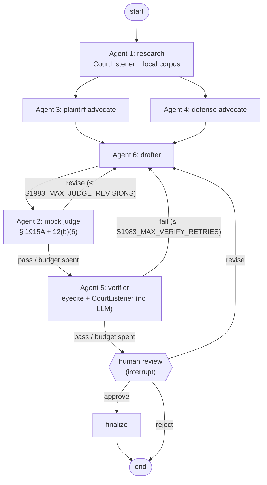

# s1983-agents

A LangGraph pipeline of six agents that researches, stress-tests, drafts, and
citation-checks a pro se 42 U.S.C. § 1983 prisoner complaint for the U.S.
District Court for the Eastern District of Michigan. Every run stops for human
review before producing a final complaint.

> This is a drafting aid, not legal advice. Nothing it produces should be filed
> until a person has read every cited authority and checked it with a citator.

## Graph



The two advocates run in parallel, and the drafter waits for both. If a loop
runs out of budget, the draft still reaches the human, and any unresolved judge
issues or verification failures are stamped at the top of the final complaint.

## How hallucinations are kept out

1. **Models never write citation strings from memory.** Agent 1 retrieves
   candidates from CourtListener (Supreme Court, Sixth Circuit, E.D. and W.D.
   Mich.) and from `data/corpus/`. The model may only *select* candidates by id.
   Code drops any id it invents (`ResearchMemo.dropped_ids`).
2. **The verifier is deterministic.** It extracts every citation from the draft
   with eyecite plus explicit patterns for U.S.C., MCL, Mich. Admin. Code,
   Fed. R. Civ. P., E.D. Mich. LR, and MDOC policy directives. A draft passes
   only if every citation is:
   - **grounded**: a case retrieved by Agent 1, or a statute/rule/policy in a
     verified corpus file;
   - **real**: the case resolves in CourtListener `/citation-lookup/`;
   - **the right case**: the resolved case name matches the cited parties;
   - and every short cite (`Ross, 578 U.S. at 643`) has a full cite earlier in
     the draft.
3. **Known gaps are surfaced as warnings:** unpublished opinions without a
   reporter citation, remaining `[FACT NEEDED]` placeholders, and the fact that
   existence checks don't prove an authority is still good law.

## Setup

Requires [mise](https://mise.jdx.dev). mise installs Python 3.13 and uv, creates
and activates `.venv`, and loads `.env`.

```bash
mise trust
mise install          # python 3.13 + uv
mise run setup        # creates .env from .env.example, runs uv sync
```

Fill in `.env`:

- `ANTHROPIC_API_KEY`
- `COURTLISTENER_API_TOKEN` (free: courtlistener.com → profile → API)
- Optionally `S1983_MODEL_<ROLE>` per agent, in `provider:model` form. To run
  the judge on another model family, install the extra (`uv sync --extra openai`)
  and set `S1983_MODEL_JUDGE=openai:<model>`.

Then fill in the primary-source corpus. Each file in `data/corpus/` is a
**placeholder** listing the official URL. Paste in the official text, set
`as_of`, and change `status: placeholder` to `status: verified`. Placeholder
files are never loaded, so until you do this, statute and policy citations will
fail verification by design. For MDOC Policy Directive 03.02.130, add the
version in force on the dates of the events.

## Usage

```bash
mise run test                                   # offline tests, no keys needed
mise run run -- --facts examples/facts.example.md
mise run verify -- path/to/any-brief.md         # citation gate only
mise run studio                                 # LangGraph Studio
```

`s1983 run` prints each agent's progress, writes `out/<thread>/draft.md` and
`review.json`, then asks you to approve, revise (with feedback for the drafter),
or reject. Use `--no-interactive` to stop at review and answer later. Runs are
checkpointed in `.state/checkpoints.sqlite`:

```bash
uv run s1983 resume --thread-id <id> --action revise --feedback "Name the housing unit"
uv run s1983 resume --thread-id <id> --action approve
```

Keep real case facts in `cases/` (git-ignored). `out/` and `.state/` are also
ignored because they contain the facts.

## Layout

```
src/s1983_agents/
  graph.py          wiring, routers, checkpointer
  nodes.py          the six agents + human gate + finalize
  prompts.py        system prompts (grounding rules, doctrine checkpoints)
  state.py          GraphState and every agent's structured output
  verifier.py       Agent 5: deterministic citation gate
  citations.py      eyecite + statute/rule/policy extraction and keys
  courtlistener.py  v4 search + citation-lookup client
  corpus.py         local primary-source corpus with keyword retrieval
  llm.py            provider-agnostic structured-output wrapper
  cli.py            s1983 run | resume | verify
data/corpus/        official texts (placeholders until you paste them)
tests/              scripted-LLM + mock-CourtListener tests of every loop
```

## Extending

- **Better retrieval:** replace `Corpus.search` with a vector store. Nothing
  else changes.
- **Good-law check:** add a node after `verifier` that pulls citing opinions
  from CourtListener `/opinions-cited/` and flags possible negative treatment
  for the human.
- **Tracing:** set the `LANGSMITH_*` variables in `.env`.
